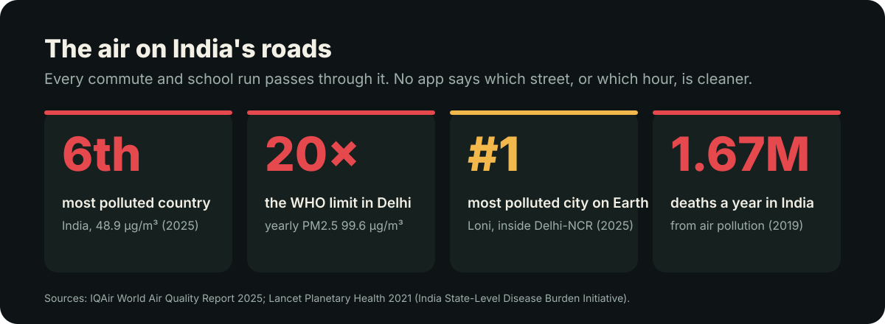
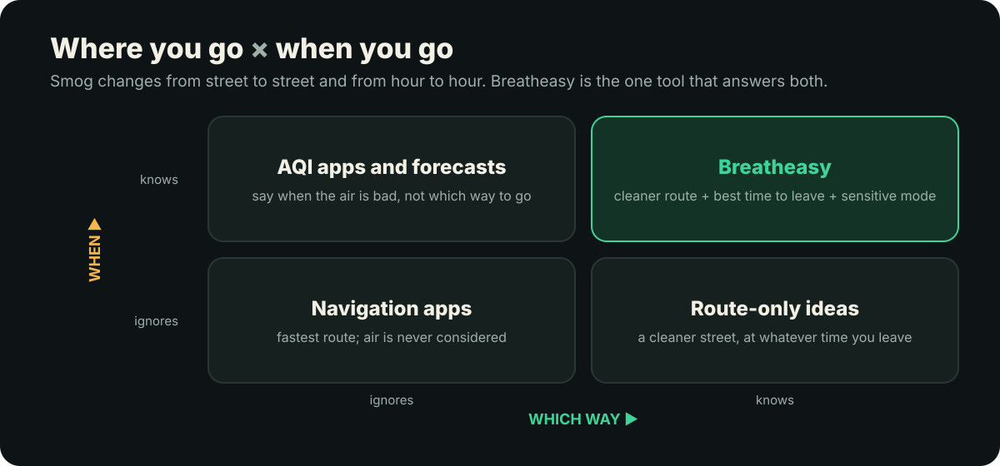
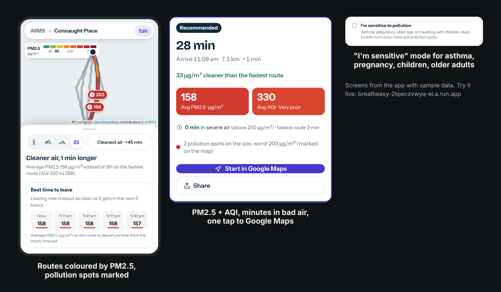
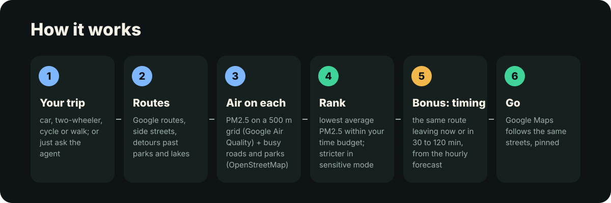
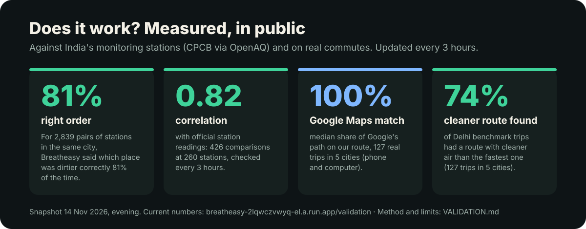

<p align="center">
  
</p>

<p align="center">
  <a href="https://breatheasy-2lqwczvwyq-el.a.run.app"></a>
  <a href="[YOUTUBE LINK]"></a>
  <a href="https://breatheasy-2lqwczvwyq-el.a.run.app/validation"></a>
  <a href="LICENSE"></a>
</p>

<p align="center"><b>Every navigation app picks the fastest road. Breatheasy picks the cleaner road, and the cleaner time to leave.</b><br>
Built by Dr Amith Paruchuri, final-year medical student at AIIMS New Delhi, for <i>Code for a Billion</i> (Climate track).</p>

---

## The problem



Hundreds of millions of Indians breathe this air on the road every day: commuters, delivery riders, children on the school run. Pollution is not the same on every street, or at every hour. Nobody can see which way, or which time, is cleaner.

## What makes Breatheasy different



| | Navigation apps | AQI apps and forecasts | **Breatheasy** |
|---|:---:|:---:|:---:|
| Which route has cleaner air | ✗ | ✗ | **✓** |
| When to leave for cleaner air | ✗ | partly | **✓ for your exact route** |
| Pollution spots on your route | ✗ | ✗ | **✓** |
| Stricter mode for asthma, pregnancy, children | ✗ | ✗ | **✓** |
| Turn-by-turn navigation | ✓ | ✗ | **✓ via Google Maps, same streets** |
| Checks itself against monitoring stations, in public | ✗ | ✗ | **✓** |

## The app



- **Which way:** routes ranked by the PM2.5 you actually pass through, with red markers on the dirtiest stretches.
- **When:** *Best time to leave* compares leaving now with 30, 60, 90 and 120 minutes later, for that same route. One tap re-plans.
- **Who:** *I'm sensitive* keeps people with asthma, pregnant women, children and older adults further from busy roads.
- **Just ask:** the commute agent understands *"reach Hauz Khas by 9 am on my cycle"* and picks the route and the departure time.
- **Go:** one tap hands the exact route to Google Maps. Share it on WhatsApp. Works anywhere in India, installable on any phone.

## How it works



Air comes from Google's Air Quality model (500 m grid, hourly forecast), adjusted street by street with OpenStreetMap: up beside busy main roads, down beside parks and lakes (Delhi-NCR, Mumbai, Kolkata, Bengaluru, Hyderabad).

## Validation and real-world impact



| Check | What we measure | Result so far |
|---|---|---|
| **Monitoring stations** (every 3 hours) | Our estimate vs official station readings, same spot and hour | **85%** right order on 1,417 station pairs · r = **0.87** · 220 comparisons at 165 stations |
| **Real commutes** (127 trips, 5 cities) | Does Google Maps follow the route we hand it? | **100%** median match, phone and computer |
| **Best time to leave** | Same route, leaving now vs up to 2 hours later | up to **26%** cleaner; median **17%** in Mumbai |
| **Cleaner routes** | Recommended vs fastest route | cleaner route on **74%** of Delhi trips, typically 3% cleaner for ~10 min |
| **People using it** | Searches, trips started on a cleaner route, departures moved to a cleaner time, "would you take it again?" | live, anonymous: [/stats](https://breatheasy-2lqwczvwyq-el.a.run.app/stats) |

**See it yourself:** [live validation page](https://breatheasy-2lqwczvwyq-el.a.run.app/validation) · [raw numbers](https://breatheasy-2lqwczvwyq-el.a.run.app/api/validation/summary) · [method and limits](VALIDATION.md)

We report modest numbers as they are: smog spreads across a city, so a route alone avoids only part of it. That is exactly why Breatheasy also tells you *when* to go.

## Built in AgentFoundry

The project lives in the AgentFoundry IDE. The commute agent ([`backend/app/agent.py`](backend/app/agent.py), with [tests](backend/tests/test_agent.py)) was built there with the Gemini CLI: the plain-language parser, the departure-time search and its tests.

## Run it

```bash
./start.sh            # macOS / Linux  (Windows: start.bat), then open http://localhost:5173
cd backend && pytest  # 109 tests
```

Runs on free open data locally, no keys needed. Production setup, architecture, costs and ranking details: [docs/TECHNICAL.md](docs/TECHNICAL.md).

**Stack:** React + TypeScript PWA · FastAPI · Postgres · Google Routes, Air Quality, Places · OpenStreetMap · Google Cloud Run (Mumbai), auto-deployed from this repo.

## Next

Paired walks with a portable PM2.5 sensor on recommended vs fastest routes · a pilot with AIIMS colleagues and patients with asthma · Hindi and other Indian languages · morning alerts for saved commutes.

<sub>MIT licence. Map data © OpenStreetMap contributors. Air data: Google Air Quality API; station readings via OpenAQ (CPCB network). Pollution facts: IQAir World Air Quality Report 2025; Lancet Planetary Health 2021.</sub>
